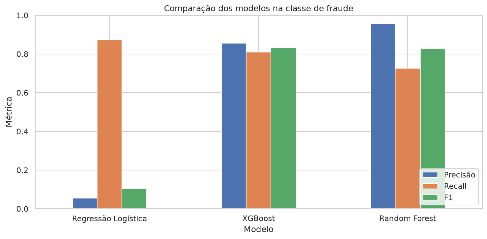
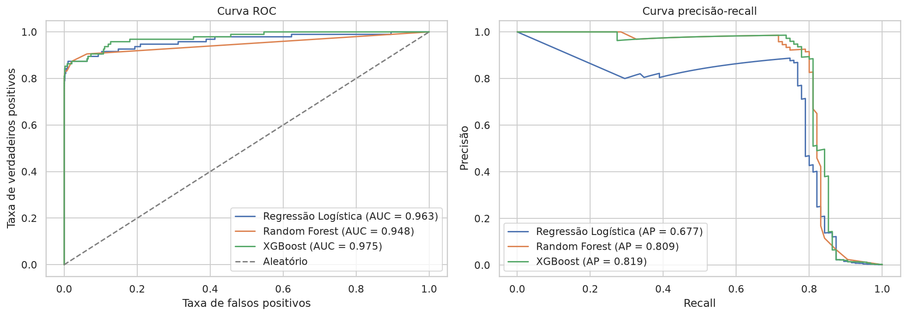
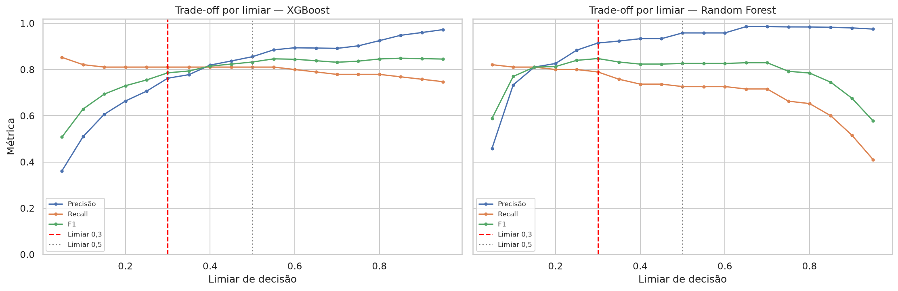
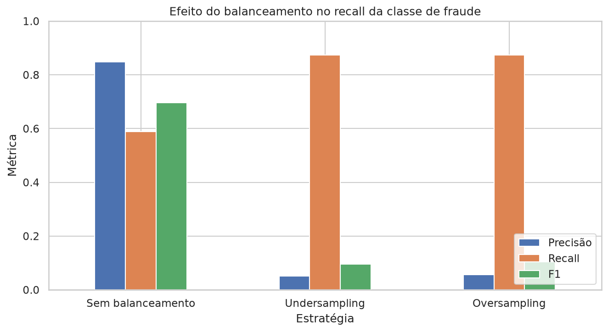
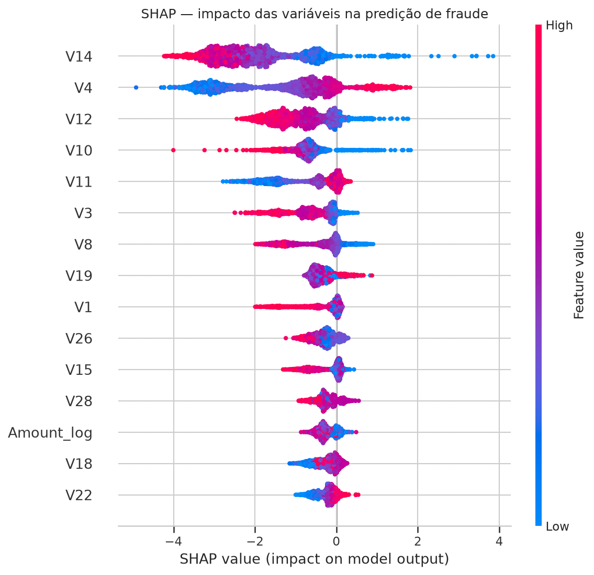
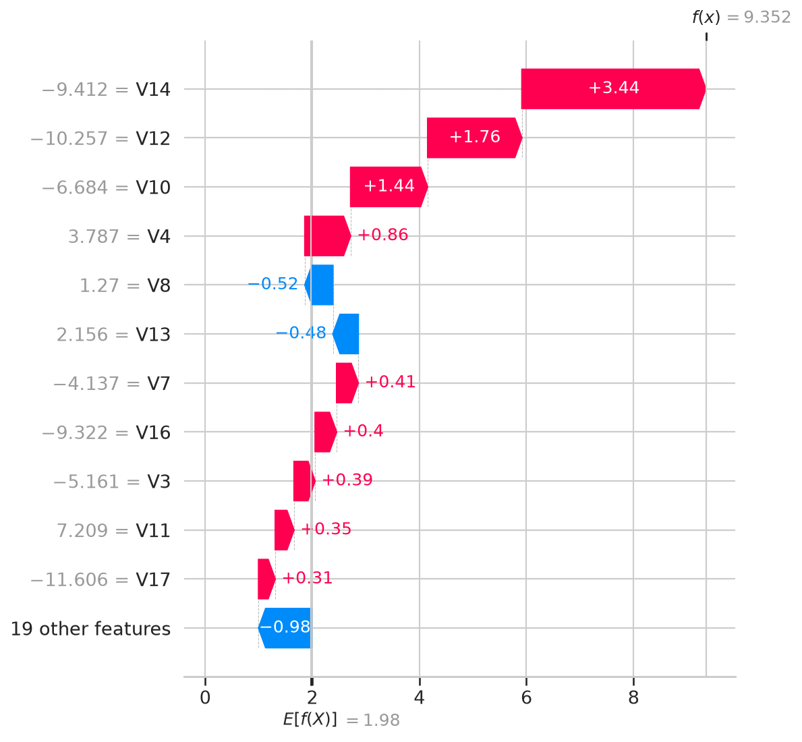

# Detecção de fraude em transações de cartão de crédito

Projeto do **Desafio de Projeto da DIO**: um notebook completo que carrega a base de transações, trata o desbalanceamento, treina e compara modelos e explica o que levou uma transação a ser marcada como fraude.

> **Resultado em destaque:** o modelo escolhido foi um **XGBoost ajustado com `GridSearchCV`** e limiar de decisão **0,3**. No conjunto de teste, ele encontrou **79 das 95 fraudes** (recall de **83,16%**), com precisão de **84,04%**, F1 de **83,60%** e PR AUC de **83,45%**.

## 📌 O problema

A base tem **284.807 transações**, das quais apenas **492 são fraudes (0,17%)**. As variáveis `V1` a `V28` passaram por PCA para proteger a privacidade; `Time` marca o momento da transação, `Amount` o valor e `Class` a resposta (1 = fraude, 0 = normal).

Um modelo que responde "não é fraude" para tudo acerta **99,83%** das transações e ainda assim não encontra nenhuma fraude. Por isso, a avaliação aqui não usa acurácia como métrica principal. O foco é a **classe de fraude**:

- **Recall:** quantas fraudes reais o modelo encontrou;
- **Precisão:** quantas das transações marcadas como fraude eram mesmo fraude;
- **F1:** equilíbrio entre precisão e recall;
- **PR AUC:** área sob a curva precisão-recall, mais informativa em bases desbalanceadas;
- **ROC AUC:** capacidade geral de separar as classes.

## 📊 Dataset

- **Fonte:** [creditcard.csv](https://storage.googleapis.com/download.tensorflow.org/data/creditcard.csv)
- **Tamanho:** 144 MB, lido diretamente pela URL no notebook.
- **Transações originais:** 284.807
- **Fraudes originais:** 492 (0,1727%)
- **Duplicatas removidas:** 1.081 linhas, sendo 19 fraudes.
- **Base final:** 283.726 transações e 473 fraudes (0,1667%).
- **Separação:** 80% treino (226.980 transações, 378 fraudes) e 20% teste (56.746 transações, 95 fraudes), com `stratify=y`.

## 🧪 O que foi feito

1. **Exploração:** leitura pela URL, inspeção das primeiras linhas, valores nulos, duplicatas, distribuição das classes, `Amount` por classe e fraudes ao longo do tempo.
2. **Preparação:** criação de `Amount_log` com `np.log1p`, padronização com `StandardScaler` dentro de um `Pipeline` (ajustado só no treino) e split estratificado.
3. **Modelos:** regressão logística com `class_weight='balanced'`, Random Forest com `class_weight='balanced'` e XGBoost com `scale_pos_weight`.
4. **Avaliação:** classification report, matriz de confusão, curvas ROC e precisão-recall, e tabela comparativa com precisão, recall, F1, ROC AUC e PR AUC.
5. **Limiar:** comparação do limiar padrão de 0,5 com 0,3 para XGBoost e Random Forest.
6. **Hiperparâmetros:** `GridSearchCV` com validação cruzada estratificada, otimizando **recall**.
7. **Explicabilidade:** importância nativa do XGBoost e SHAP (summary plot e waterfall de uma fraude).
8. **Balanceamento:** comparação entre sem balanceamento, undersampling e oversampling.

### Decisões técnicas importantes

- **Duplicatas removidas antes do split.** Se a mesma transação aparecesse no treino e no teste, as métricas ficariam infladas.
- **Padronização dentro do `Pipeline`.** O `StandardScaler` é ajustado apenas nos dados de treino de cada divisão, evitando vazamento.
- **Métrica principal: recall da fraude.** Em fraude, deixar passar custa mais caro do que investigar um falso positivo. A precisão entra como contrapeso.
- **`random_state=42` em tudo.** O notebook é reprodutível.

## 📈 Resultados

### Comparação dos modelos no limiar 0,5

| Modelo              |   Precisão |     Recall |         F1 |    ROC AUC |     PR AUC |
| ------------------- | ---------: | ---------: | ---------: | ---------: | ---------: |
| Regressão Logística |      5,54% | **87,37%** |     10,42% |     0,9625 |     0,6770 |
| Random Forest       | **95,83%** |     72,63% |     82,63% |     0,9478 |     0,8093 |
| XGBoost             |     85,56% |     81,05% | **83,24%** | **0,9752** | **0,8188** |

A regressão logística encontra muitas fraudes, mas erra muito: a precisão de 5,54% significa que a maioria dos alertas é falso positivo. O Random Forest é o mais preciso, porém deixa passar mais fraudes. O XGBoost tem o melhor equilíbrio entre recall, F1 e PR AUC.





### Efeito do limiar de decisão

| Modelo               | Limiar | Precisão |     Recall |         F1 |
| -------------------- | -----: | -------: | ---------: | ---------: |
| XGBoost              |    0,5 |   85,56% |     81,05% |     83,24% |
| XGBoost              |    0,3 |   76,24% |     81,05% |     78,57% |
| Random Forest        |    0,5 |   95,83% |     72,63% |     82,63% |
| Random Forest        |    0,3 |   91,46% |     78,95% | **84,75%** |
| XGBoost GridSearchCV |    0,5 |   89,29% |     78,95% |     83,80% |
| XGBoost GridSearchCV |    0,3 |   84,04% | **83,16%** |     83,60% |

Um achado importante: **baixar o limiar para 0,3 não ajuda todos os modelos**. No XGBoost original, o recall ficou igual e a precisão caiu. No Random Forest, o limiar 0,3 subiu o recall de 72,63% para 78,95% e o F1 de 82,63% para 84,75%. Já no XGBoost ajustado pelo `GridSearchCV`, o limiar 0,3 subiu o recall de 78,95% para 83,16%.



### Modelo escolhido

**XGBoost ajustado com `GridSearchCV` + limiar 0,3.**

- Melhores parâmetros: `max_depth=3`, `n_estimators=200`.
- Recall na validação cruzada (limiar 0,5): 82,54%.
- No teste (limiar 0,3): **precisão 84,04%, recall 83,16%, F1 83,60%, ROC AUC 0,9714 e PR AUC 0,8345**.
- Em números absolutos: **79 das 95 fraudes encontradas**, com **15 falsos positivos**.

A escolha prioriza recall. Se o custo de investigar um falso positivo for muito alto, o **Random Forest com limiar 0,3** é uma alternativa atraente: precisão de 91,46%, recall de 78,95% e F1 de 84,75%, com apenas 7 falsos positivos.

### Comparação com undersampling e oversampling

| Estratégia        | Precisão | Recall |     F1 | PR AUC |
| ----------------- | -------: | -----: | -----: | -----: |
| Sem balanceamento |   84,85% | 58,95% | 69,57% | 0,7010 |
| Undersampling     |    5,04% | 87,37% |  9,52% | 0,5869 |
| Oversampling      |    5,56% | 87,37% | 10,46% | 0,6769 |

As duas estratégias aumentam o recall, mas derrubam a precisão. O melhor caminho neste projeto foi o **peso de classe** (`scale_pos_weight`) combinado com o ajuste de limiar.



## 🔍 O que o SHAP mostrou

As variáveis de maior impacto global foram **V14, V4, V12, V10 e V11**. A importância nativa do XGBoost também coloca **V14** e **V10** no topo.



Na transação de fraude explicada no notebook, a probabilidade prevista foi **0,9999**. As principais contribuições foram:

- **V14 (+3,44)**, **V12 (+1,76)**, **V10 (+1,44)** e **V4 (+0,86)** empurram a predição para fraude;
- **V8 (−0,52)** e **V13 (−0,48)** puxaram para o lado normal.



> Os valores SHAP estão na escala padronizada das variáveis, porque o `StandardScaler` faz parte do `Pipeline`. Eles mostram associação aprendida pelo modelo, não causalidade.

## 🔄 O que mudou em relação à aula da Expert

1. **Remoção de duplicatas antes do split.** A base original tem 1.081 linhas duplicadas, incluindo 19 fraudes. Removê-las evita vazamento entre treino e teste.
2. **PR AUC e curva precisão-recall como métricas centrais.** A acurácia e a ROC AUC podem parecer boas mesmo quando o modelo é ruim na classe de fraude.
3. **Teste do limiar por modelo, não de forma cega.** O 0,3 ajudou o Random Forest e o XGBoost ajustado, mas não o XGBoost original.
4. **`GridSearchCV` no XGBoost otimizando recall.** A busca escolheu `max_depth=3` e `n_estimators=200`.
5. **SHAP com waterfall de uma fraude específica.** Além da importância global, o notebook explica uma decisão individual.
6. **Comparação entre undersampling e oversampling.** As duas estratégias foram testadas e comparadas pelo recall e pelo F1.
7. **Pipeline em todos os modelos.** A padronização é ajustada apenas no treino, sem vazamento.
8. **Semente fixa e resultados salvos.** O notebook roda do início ao fim e deixa as saídas, tabelas e curvas salvas.

## 🚀 Como executar

### Pré-requisitos

- [mise](https://mise.jdx.dev/) para instalar o Python e o `uv`.
- Nenhuma instalação manual de Python é necessária.

### Passo a passo

```bash
# 1. Instalar o mise (uma vez)
curl https://mise.run | sh

# 2. Confiar e instalar as ferramentas do projeto (Python 3.12 + uv)
mise trust
mise install

# 3. Instalar as dependências do notebook
uv sync

# 4. Abrir o JupyterLab
uv run jupyter lab
```

Depois, abra `deteccao_fraude.ipynb` e execute as células em ordem. O notebook baixa o dataset automaticamente pela URL.

Para executar o notebook inteiro pela linha de comando:

```bash
uv run jupyter nbconvert --to notebook --execute --inplace deteccao_fraude.ipynb \
  --ExecutePreprocessor.kernel_name=python3 \
  --ExecutePreprocessor.timeout=1800
```

> O notebook usa o kernel `python3` do ambiente virtual criado pelo `uv`. Se ele não aparecer no JupyterLab, registre um kernel nomeado:
>
> ```bash
> uv run python -m ipykernel install --user --name dio-fraude --display-name "Python (dio-fraude)"
> ```
>
> Depois selecione **Python (dio-fraude)** no notebook.

### Dependências principais

`pandas`, `numpy`, `scikit-learn`, `xgboost`, `shap`, `matplotlib`, `seaborn`, `imbalanced-learn`, `jupyterlab`, `ipykernel`, `nbconvert` e `nbformat`. As versões exatas estão no `uv.lock`.

## 📁 Estrutura do repositório

```
.
├── PLAN.md                    # Enunciado do desafio
├── README.md                  # Este arquivo
├── deteccao_fraude.ipynb      # Notebook completo, com saídas salvas
├── mise.toml                  # Python 3.12 + uv
├── pyproject.toml             # Dependências do projeto
├── uv.lock                    # Versões travadas
├── .gitignore                 # Ignora o dataset, .venv e caches
├── images/                    # Gráficos exportados para o README
│   ├── 01_distribuicao_classes.png
│   ├── 02_amount_por_classe.png
│   ├── 03_fraudes_por_hora.png
│   ├── 04_comparacao_modelos.png
│   ├── 05_curvas_roc_pr.png
│   ├── 06_limiar_decisao.png
│   ├── 07_importancia_variaveis.png
│   ├── 08_shap_summary.png
│   ├── 09_shap_waterfall.png
│   └── 10_amostragem.png
└── resultados/                # Métricas em CSV
    ├── metricas_modelos.csv
    ├── metricas_limiares.csv
    ├── metricas_finais.csv
    └── metricas_amostragem.csv
```

## ⚠️ Limitações e próximos passos

- **Split aleatório, não temporal.** Em produção, uma validação por tempo é mais realista, porque o modelo precisa generalizar para transações futuras.
- **Base de 2013 e de portadores europeus.** O comportamento pode não se repetir em outros mercados ou épocas.
- **Probabilidades não calibradas.** O `scale_pos_weight` melhora o recall, mas distorce as probabilidades. Uma evolução é usar `CalibratedClassifierCV`.
- **Limiar depende do custo de negócio.** O 0,3 foi escolhido priorizando recall; se o custo de falso positivo for alto, o limiar deve subir.
- **SHAP mostra associação, não causalidade.** As variáveis explicam o modelo, não necessariamente o fenômeno real.
- **`GridSearchCV` otimizou recall no limiar 0,5.** Uma evolução é usar um scorer customizado no limiar escolhido.
- **Próximos modelos:** LightGBM, CatBoost e redes neurais tabulares, sempre comparados pelo recall e pelo PR AUC.

## ✅ Checklist do desafio

- [x] Notebook roda do início ao fim, sem célula quebrada.
- [x] Dataset lido pelo link da base, não pelo arquivo local.
- [x] `creditcard.csv` no `.gitignore` e fora do repositório.
- [x] Saídas, tabelas e curvas salvas no notebook.
- [x] README explica problema, preparação, comparação, limiar e SHAP.
- [x] Todos os arquivos citados no README existem.
- [x] Projeto reproduzível com `mise` + `uv`.
- [x] Nenhum commit ou alteração no histórico do git foi feito.
